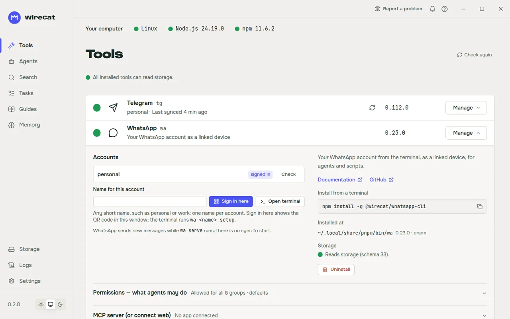
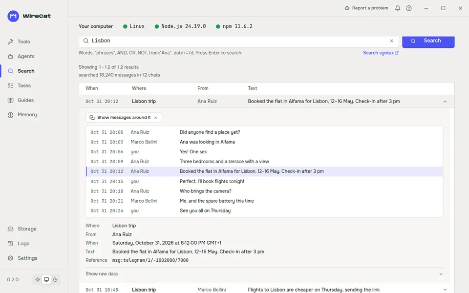
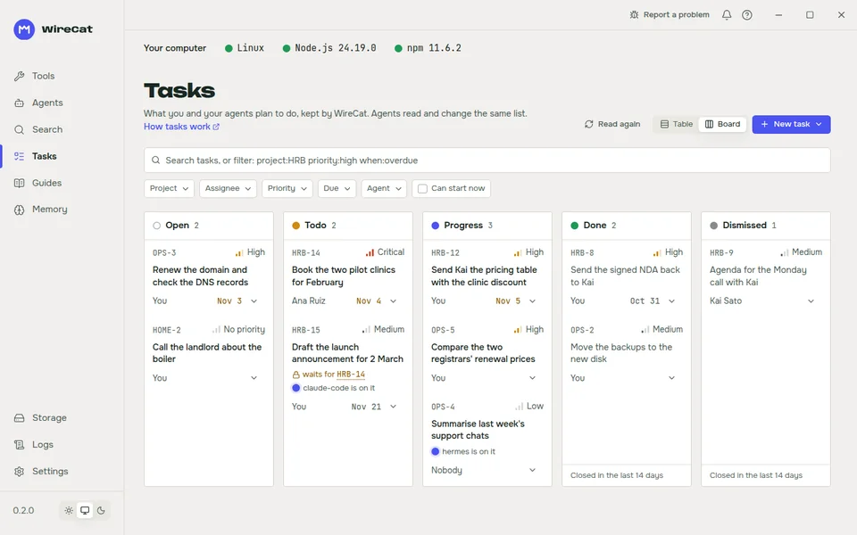
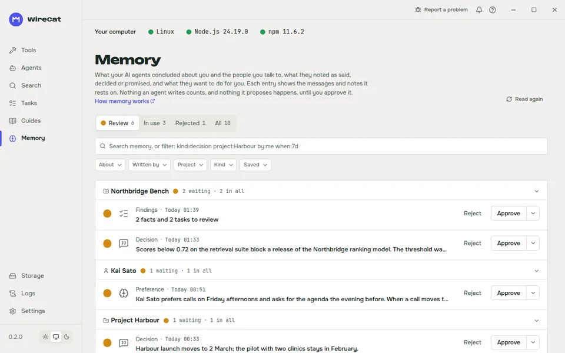
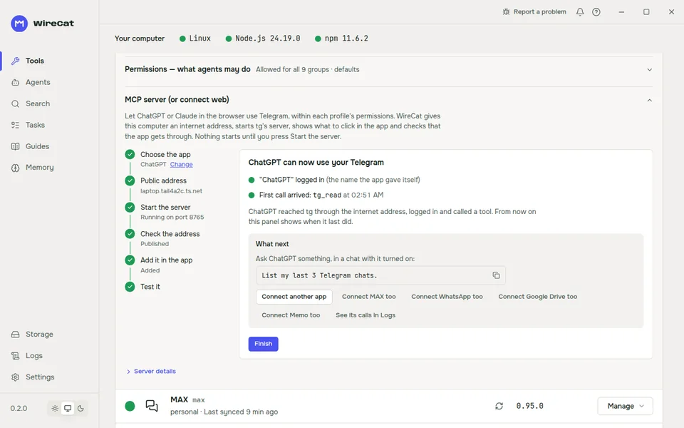

# WireCat Desktop

Install, sign in to, connect and check the [WireCat](https://wirecat.dev) tools for AI agents, without typing npm
commands.

WireCat gives your AI agent your messengers (Telegram, WhatsApp, MAX), then your mail, Zoom meetings, Google Drive
documents and notes. Each service has a small command-line tool. WireCat Desktop is the window that installs those
tools, signs you in, and connects them to Claude Code, Codex, ChatGPT, Claude and other agents. Everything stays on
your computer.

[Releases](https://github.com/WireCatLabs/wirecat-desktop/releases) · [WireCat](https://wirecat.dev) ·
[Report a problem](https://github.com/WireCatLabs/wirecat-desktop/issues)

[](https://github.com/WireCatLabs/wirecat-desktop/actions/workflows/ci.yml)
[](https://github.com/WireCatLabs/wirecat-desktop/releases/latest)
[](LICENSE)

<picture>
  <source media="(prefers-color-scheme: dark)" srcset="docs/images/tools-dark.webp">
  
</picture>

## Quick start

1. Download the file for your system from the [download page](https://wirecat.dev/en/download) or the
   [latest release](https://github.com/WireCatLabs/wirecat-desktop/releases/latest):

   | System | File type |
   | --- | --- |
   | macOS | `.dmg` (universal) |
   | Windows | `.exe` installer (64 bit) |
   | Linux (Debian, Ubuntu) | `.deb` (amd64) |
   | Linux (Fedora, RHEL) | `.rpm` (x86_64) |
   | Linux (other) | `.AppImage` (amd64) |

2. Install it like any other app and open **WireCat**. On Linux, the download page has the full command for the
   current version. For a `.deb` you already downloaded, copy it to `/tmp` first: apt reads the file as its own
   restricted user, which cannot open your home folder, and prints a notice about it.

   ```sh
   cp ~/Downloads/wirecat_*_amd64.deb /tmp/ && sudo apt install /tmp/wirecat_*_amd64.deb
   ```

   Keep only one WireCat `.deb` in Downloads, or the pattern matches several files. For an `.rpm`, run
   `sudo dnf install ~/Downloads/wirecat-*.x86_64.rpm`. The install prints what to do next.
3. The first start opens a short setup: your computer, which tools to install, which agents to connect, and
   sign-in. You can skip it and open the **Tools** page instead.

WireCat Desktop starts without Node.js. The tools it installs need Node.js 22.16 or newer (or 24 or newer) with npm.
If Node.js is missing or too old, the app says so. It can set up its own copy of Node.js in your user folder, and your
own copy stays as it is.

The app looks for updates while it runs and offers a new version when there is one. On Linux, a `.deb` or `.rpm` copy
downloads the new package to your Downloads folder and hands it to the system's installer.

## What you can do

The sidebar has these pages:

| Page | What it does |
| --- | --- |
| Tools | Shows every WireCat tool, which are installed and in which version. Installs, updates and uninstalls them, runs a tool's own health check, and signs in to an account. |
| Agents | Finds the AI agents on this computer and gives them each tool's skill and MCP server. Also connects ChatGPT and Claude in the browser through a tool's MCP server. |
| Search | Searches what one tool keeps on this computer, for one account. It reads the local copy only and never asks the service. Your agent can write the query from a plain sentence. |
| Tasks | One task list for you and your agents, as a table or a board. Memo keeps it, and agents read and change the same list. |
| Guides | Ready prompts for your agent, such as a catch-up on what you missed or a brief before a call. Each one says which tools and commands it uses. |
| Memory | What your agents concluded about you and the people you talk to, and what they propose to do. Nothing counts until you approve it. Memo keeps it. |
| Storage | Shows the data folders of each tool and the shared archive. Makes a backup of the shared archive (with an optional password) and clears it. |
| Logs | Shows every run of every tool, read from the tool's own run log. |
| Settings | Shows and changes each tool's settings, and the app's own language and interface size. The app has a light and a dark theme. |

The app has three languages: English, Russian and Spanish. It follows your system language.

On each tool you can also:

- Start a sync for an account and watch its progress.
- See and change what agents may do (the permission levels) for each account.
- Start the tool's MCP server for browser apps. For a public address, WireCat can turn on Tailscale Funnel or start a
  Cloudflare tunnel on your own domain.

| | |
| --- | --- |
| <picture><source media="(prefers-color-scheme: dark)" srcset="docs/images/search-hit-dark.webp"></picture> | <picture><source media="(prefers-color-scheme: dark)" srcset="docs/images/tasks-dark.webp"></picture> |
| **Search** what you synced, and open a result to read the conversation around it. | **Tasks** that you and your agents share. |
| <picture><source media="(prefers-color-scheme: dark)" srcset="docs/images/memory-dark.webp"></picture> | <picture><source media="(prefers-color-scheme: dark)" srcset="docs/images/connect-dark.webp"></picture> |
| **Memory** that waits for your approval. | **Connect** ChatGPT or Claude in the browser, step by step. |

The screenshots show made-up data.

## The tools

The app installs the same npm packages as a command-line user.

| Tool | Command | Package |
| --- | --- | --- |
| Telegram | `tg` | `@wirecat/tg-cli` |
| MAX | `max` | `@wirecat/max-cli` |
| WhatsApp | `wa` | `@wirecat/whatsapp-cli` |
| Zoom | `zm` | `@wirecat/zoom-cli` |
| Google Drive | `drive` | `@wirecat/drive-cli` |
| Memo | `memo` | `@wirecat/cli-memo` |
| Email | `memo mail` | `@wirecat/cli-memo`, installed with Memo |

## For AI agents

The agent runs the tools. The app only prepares them.

- It finds Claude Code, Codex, Cursor, Gemini CLI, OpenCode, Hermes Agent and OpenClaw on your computer.
- For each agent it installs a tool's skill and registers its MCP server, using the tool's own commands.
- For ChatGPT and Claude in the browser, it starts the tool's HTTP MCP server and shows the address, a login code and
  the steps to click in that app.
- It looks for tools the way a terminal does, also when started from a launcher that has a short PATH (nvm, pnpm,
  Volta, Homebrew).

## Why WireCat Desktop

- **It is optional.** `npm install -g @wirecat/tg-cli` works exactly as before. Nobody needs the app.
- **The tools do the work.** The app runs each tool's own sign-in, sync and health check. It never reimplements them.
  A missing feature is added to the tool, not to the app.
- **It shows the real state.** Versions come from running the program, not from a package list. When something cannot
  be checked, the app says so.
- **It never picks an account for you.** Every command that needs an account profile uses the one you chose.
- **It asks for operations, not command lines.** The interface sends a tool id and checked arguments. The native part
  maps them to fixed programs. There is no shell plugin and no free command box.

## Security

- **Everything stays on your computer.** The app has no account and no server of its own for your data.
- **No administrator rights.** The app never calls `sudo` and never installs into a system folder. When a step needs
  more rights, it explains the fix.
- **Tool output is masked** (tokens, phone numbers, addresses and names) before it reaches the interface, the
  clipboard or a log. The run log is the one exception: you read it as the tool wrote it, and the tool has already
  hidden secrets and phone numbers.
- **Deleting data is narrow.** The app removes only each tool's own folders, only when no installed tool uses them,
  and only after you confirm in a dialog that lists every path. Emptying the shared archive uses the tool's own
  `store reset` behind a dialog that lists what it deletes.
- **Updates are checked.** An update is checked against a signature before it installs.
- **The app connects to** the npm registry (versions and installs), nodejs.org (only if you ask for its own Node.js),
  GitHub (updates and the cloudflared download) and `api.wirecat.dev` (only when you send a bug report).
- **A bug report is yours to send.** It becomes a public issue on GitHub. Email addresses, phone numbers and tokens are
  masked before it leaves your computer. Logs go to private storage and are never in the public issue. For a security
  problem, use the repository's [WireCat security policy](https://github.com/WireCatLabs/.github/blob/main/SECURITY.md) instead.

## When it does not work

- **"Node.js is needed"** or **"too old"**: use the app's offer to set up Node.js, or install Node.js 22.16 or newer
  yourself, then check again.
- **A tool is installed but the app does not find it:** the app lists every copy in PATH order. The first copy is the
  one a terminal runs. If an older copy comes first, remove it or put the newer one first.
- **An install stops:** the install panel names the reason and keeps the raw log one click away. Open **Report a
  problem** in the app to send it.
- **Hermes or OpenClaw cannot run a tool:** they start commands from their own PATH. The Agents page shows the exact
  folders to add.

## Documentation

- [WireCat documentation](https://wirecat.dev)
- [Releases](https://github.com/WireCatLabs/wirecat-desktop/releases)
- [Architecture](docs/dev/ARCHITECTURE.md): the layers and how a request travels from a button to a process
- [Product](PRODUCT.md) and [design](DESIGN.md)
- [Bug report API](docs/dev/report-api.md)

## Development

```sh
pnpm install
pnpm dev        # the interface in a browser, with Rust mocked: http://localhost:1420
pnpm app        # the real desktop app
pnpm check      # types, lint, tests, rustfmt, clippy, Rust tests
```

To build from source you need Node.js, pnpm and a Rust toolchain. On Debian or Ubuntu, run `bin/install-linux-deps`
once for the Tauri build libraries; other systems are in
[Tauri's prerequisites](https://v2.tauri.app/start/prerequisites/). `pnpm build` builds the interface, and
`pnpm tauri build` makes the installers.

`pnpm dev` takes scenarios in the address, such as `?state=fresh` for a machine with nothing installed; the list is in
[CLAUDE.md](CLAUDE.md). Working rules for people and agents are in [CLAUDE.md](CLAUDE.md) and [AGENTS.md](AGENTS.md).

## Contributing

Bug reports and pull requests are welcome. Read the
[contributing guide](https://github.com/WireCatLabs/.github/blob/main/CONTRIBUTING.md) first. Where to ask
questions is in the [support page](https://github.com/WireCatLabs/.github/blob/main/SUPPORT.md).

## Part of WireCat

WireCat Desktop is one part of [WireCat](https://wirecat.dev), with the command-line tools it installs.

## Licence

Apache 2.0. See [LICENSE](LICENSE).
