# WireCat Desktop

**Everything you've said, ready for your agent.**

[WireCat](https://wirecat.dev) connects the AI agent you already use — Claude Code, Codex, Cursor, Gemini CLI,
ChatGPT, Claude and others — to your Telegram, WhatsApp and MAX chats, Zoom meetings, Google Drive documents,
calendar, mail and notes. Each service has a small open-source command-line tool. The tools sync your data into one
local store on your computer, so your agent can search it, quote its sources and act within limits you set. Nothing
goes to a WireCat server.

WireCat Desktop is the app for all of it. You use it to set the tools up, and then to see and work with what they
keep: search your chats, share a task list with your agents, approve what they remember, and decide what each agent
may do.

[Download](https://wirecat.dev/en/download) · [Releases](https://github.com/WireCatLabs/wirecat-desktop/releases) ·
[WireCat](https://wirecat.dev) · [Report a problem](https://github.com/WireCatLabs/wirecat-desktop/issues)

[](https://github.com/WireCatLabs/wirecat-desktop/actions/workflows/ci.yml)
[](https://github.com/WireCatLabs/wirecat-desktop/releases/latest)
[](LICENSE)

## Key features

- **Search everything you synced.** One search over your chats, meetings and notes, read from the copy on your
  computer. Open a result to see the conversation around it and the exact source.
- **Connect any agent.** Finds Claude Code, Codex, Cursor, Gemini CLI and other agents on your computer and gives
  them each tool's skill and MCP server. Connects ChatGPT and Claude in the browser step by step.
- **Decide what agents may do.** Set the permission level for each account.
- **Approve what agents remember.** Conclusions about you and the people you talk to wait in a review queue. Nothing
  counts until you approve it.
- **Share tasks with your agents.** One task list, as a table or a board, that you and your agents both change.
- **Ready-made guides.** Prompts for your agent, such as a catch-up on what you missed or a brief before a call.
- **Manage the tools.** Install, update and remove the WireCat CLI tools, sign in to accounts, run syncs and health
  checks, without typing npm commands.
- **Your data, under your control.** Back up or clear the local store, read every tool run in the logs, and change
  settings in one place. In English, Russian and Spanish, with a light and a dark theme.

<picture>
  <source media="(prefers-color-scheme: dark)" srcset="docs/images/search-hit-dark.webp">
  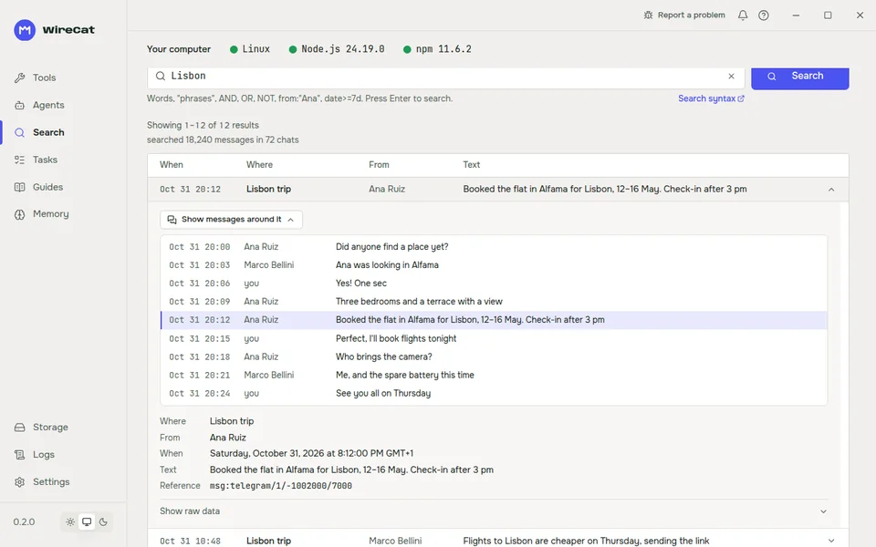
</picture>

## Install

WireCat Desktop runs on:

- **macOS**, on Apple Silicon and Intel
- **Windows**, 64-bit
- **Linux**, 64-bit (x86_64), with packages for the common distributions and a portable build for the rest

1. Get the installer for your system from the [download page](https://wirecat.dev/en/download) or the
   [latest release](https://github.com/WireCatLabs/wirecat-desktop/releases/latest). The download page also has
   the install command for Linux.
2. Install it like any other app and open **WireCat**.
3. The first start opens a short setup: your computer, which tools to install, which agents to connect, and
   sign-in. You can skip it and open the **Tools** page instead.

The app looks for updates while it runs and offers a new version when there is one.

## Pages

The sidebar has these pages, top to bottom:

| Page | What it does |
| --- | --- |
| Tools | Two tabs. **Tools** shows every WireCat CLI tool, which are installed and in which version, and installs, updates and uninstalls them, runs a tool's own health check and signs in to an account. **Agents** finds the AI agents on this computer and gives them each tool's skill and MCP server, connects ChatGPT and Claude in the browser through a tool's MCP server, and holds **Schedules and digests**: the digests an agent writes on a schedule, with the presets to make one. **All digests** there opens the archive of every digest. |
| Tasks | One task list for you and your agents, as a table or a board. Memo keeps it, and agents read and change the same list. |
| Clients | Deals and leads from your CRM and messages, as a table or a board by stage. |
| Contacts | Who is who across your sources, and the matches to confirm. |
| Memory | What your agents concluded about you and the people you talk to, and what they propose to do. Nothing counts until you approve it. Memo keeps it. |
| Guides | Ready prompts for your agent, such as a catch-up on what you missed or a brief before a call. Each one says which tools and commands it uses. |
| Analytics | Two tabs. **Data** counts your messages, chats and projects over time. **Storage** shows the data folders of each tool and the shared archive, makes a backup of the shared archive (with an optional password) and clears it. |
| Search | Searches what one tool keeps on this computer, for one account. It reads the local copy only and never asks the service. Your agent can write the query from a plain sentence. |
| Logs | Shows every run of every tool, read from the tool's own run log. |
| Settings | Shows and changes each tool's settings, and the app's own language and interface size. The app has a light and a dark theme. |

A digest that arrives shows in the bell at the top; its **Open the digest** reads it.

The app has three languages: English, Russian and Spanish. It follows your system language.

On each tool you can also:

- Start a sync for an account and watch its progress.
- See and change what agents may do (the permission levels) for each account.
- Start the tool's MCP server for browser apps. For a public address, WireCat can turn on Tailscale Funnel or start a
  Cloudflare tunnel on your own domain.

| | |
| --- | --- |
| <picture><source media="(prefers-color-scheme: dark)" srcset="docs/images/tools-dark.webp">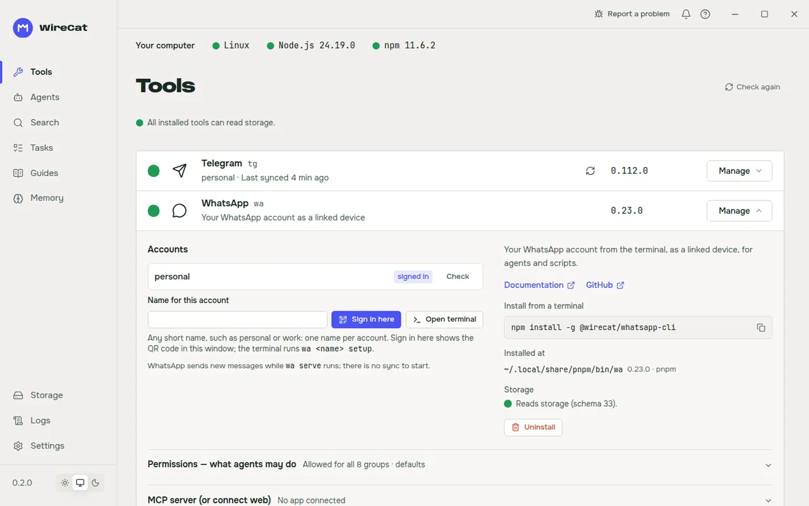</picture> | <picture><source media="(prefers-color-scheme: dark)" srcset="docs/images/tasks-dark.webp">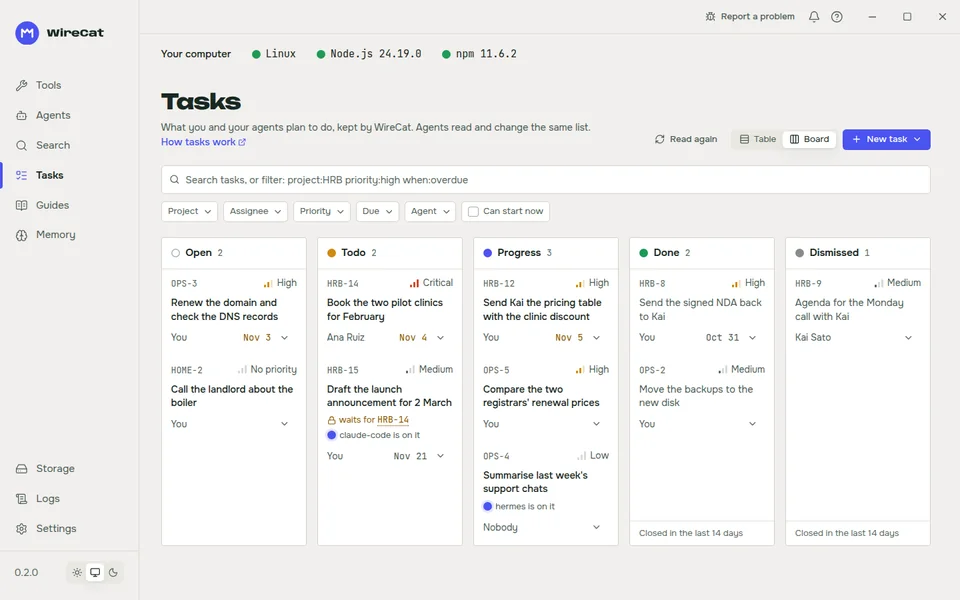</picture> |
| **Tools** installed, signed in and synced, each with its accounts and checks. | **Tasks** that you and your agents share. |
| <picture><source media="(prefers-color-scheme: dark)" srcset="docs/images/memory-dark.webp">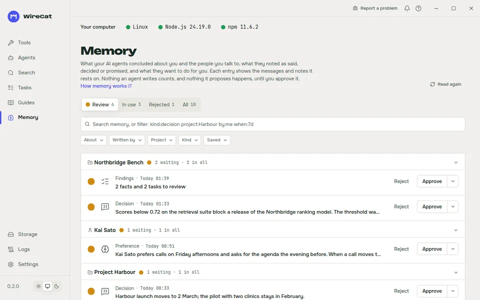</picture> | <picture><source media="(prefers-color-scheme: dark)" srcset="docs/images/connect-dark.webp">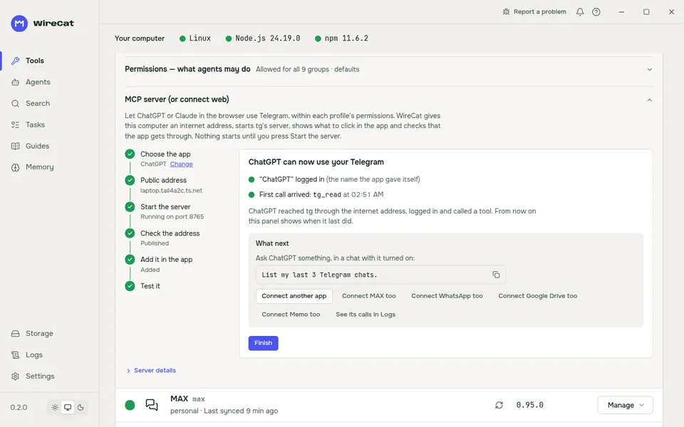</picture> |
| **Memory** that waits for your approval. | **Connect** ChatGPT or Claude in the browser, step by step. |

The screenshots show made-up data.

## The tools

The app installs the same npm packages as a command-line user.

| Tool | Command | Package |
| --- | --- | --- |
| [Telegram](https://wirecat.dev/en/docs/tg) | `tg` | `@wirecat/tg-cli` |
| [MAX](https://wirecat.dev/en/docs/max) | `max` | `@wirecat/max-cli` |
| [WhatsApp](https://wirecat.dev/en/docs/wa) | `wa` | `@wirecat/whatsapp-cli` |
| [Zoom](https://wirecat.dev/en/docs/zm) | `zm` | `@wirecat/zoom-cli` |
| [Google Drive](https://wirecat.dev/en/docs/drive) | `drive` | `@wirecat/drive-cli` |
| [Google Calendar](https://wirecat.dev/en/docs/gcal) | `gcal` | `@wirecat/gcal-cli` |
| [Memo](https://wirecat.dev/en/docs/memo) | `memo` | `@wirecat/cli-memo` |
| [Email](https://wirecat.dev/en/docs/mail) | `mail` | `@wirecat/mail-cli` |

## Tools from outside WireCat

The Tools page can list three kinds of tool:

| Kind | Where it comes from | Badge |
| --- | --- | --- |
| WireCat's own | Built into the app | none |
| Community | A list that WireCat reviews and signs | **Community** |
| Not verified | Added by you, by its npm name | **Not verified** |

The second and third kinds are off by default. Settings has one switch for each. **Enable community tools** takes
effect at the next start, and the page offers **Restart now**. **Allow tools WireCat has not checked** takes effect at
once.

<picture>
  <source media="(prefers-color-scheme: dark)" srcset="docs/images/own-settings-dark.webp">
  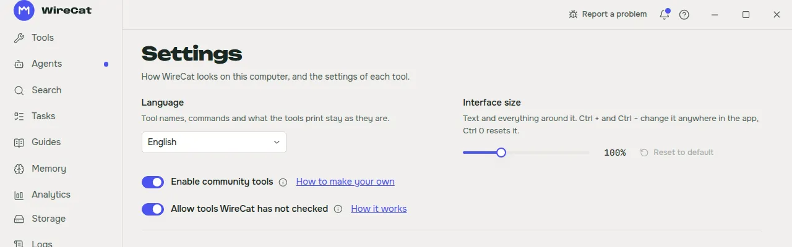
</picture>

### Community tools

Turn on **Enable community tools**. The app then reads the signed list and shows its tools with the **Community**
badge. Install one with its **Install** button, like any tool. The app installs a release only when npm built it from
the tool's own repository. The review checks how a tool is built and released, not everything it does. No community
tool is listed yet.

The signed list is valid for 30 days, and WireCat fetches a new one every day. When seven days or fewer are left, a
notice at the top of the app says when the list runs out. After that, community tools cannot be installed or updated until a new list
arrives; installed ones keep working. Your own tools do not use the list.

### Add your own tool

For a tool that is not on the list: your own, a colleague's, or one from a private repository.

1. In Settings, turn on **Allow tools WireCat has not checked**. A warning opens. Confirm it with **Allow**.
2. On the Tools page, click **Add your own tool**, at the top next to **Check again**. Type the npm name, such as `@scope/name`, and click
   **Check package**. WireCat only reads npm. Nothing is installed, and no code of the package runs.
3. Read the review screen (below), then click **Add**.
4. WireCat offers **Check it with your AI agent** first. Your agent (Claude Code, Codex or Gemini, when one is
   installed) opens in a terminal with a prepared request: download exactly the reviewed package file, check its
   sha512, read the code, compare it with the repository at the release commit, and report what it contacts, what it
   reads and writes, and anything suspicious. It never installs or runs the package. With no agent found, **Copy the
   check** and paste it into yours. Or click **Skip and install**.
5. A second question asks: "Install and run `@scope/name`? Its install scripts and first run use your permissions."
   Only **Install and run** installs the package.
6. After the install, WireCat checks that the program describes itself as the review showed. The tool is on the Tools
   page at once, with the **Not verified** badge. No restart is needed.

Only some packages work. The package must have a scope (`@scope/name`, not `@wirecat/`), be written in TypeScript on
[cli-base](https://github.com/WireCatLabs/cli-base) (for example made with cli-template), and ship its manifest
`contracts/wirecat.json`. A program on your PATH or a package without a scope cannot be added.

| | |
| --- | --- |
| <picture><source media="(prefers-color-scheme: dark)" srcset="docs/images/own-name-dark.webp">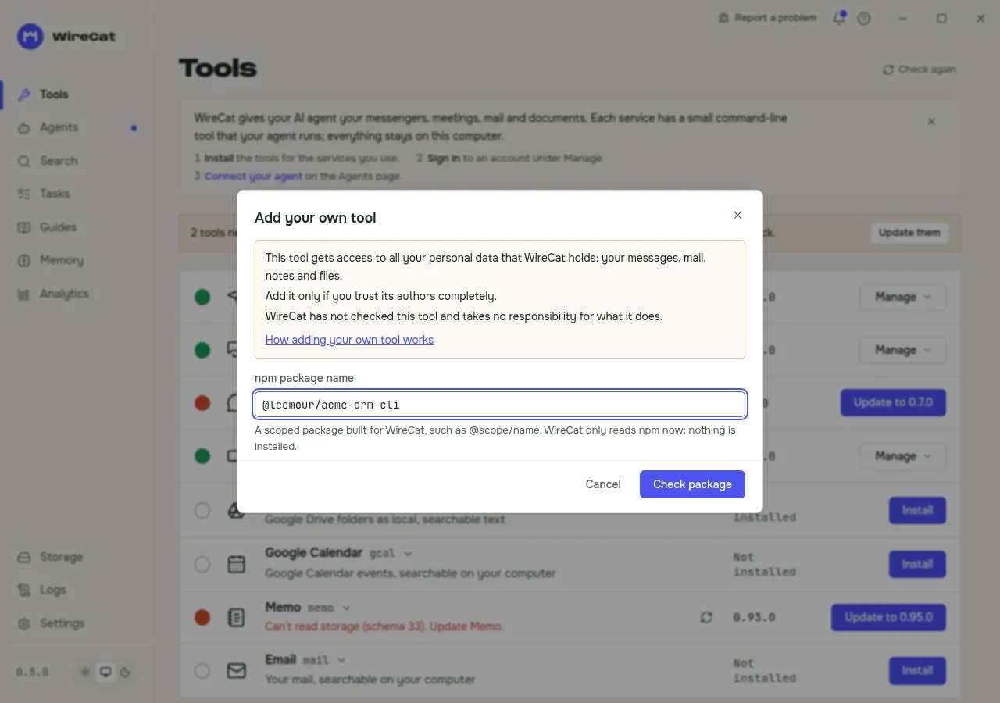</picture> | <picture><source media="(prefers-color-scheme: dark)" srcset="docs/images/own-review-dark.webp">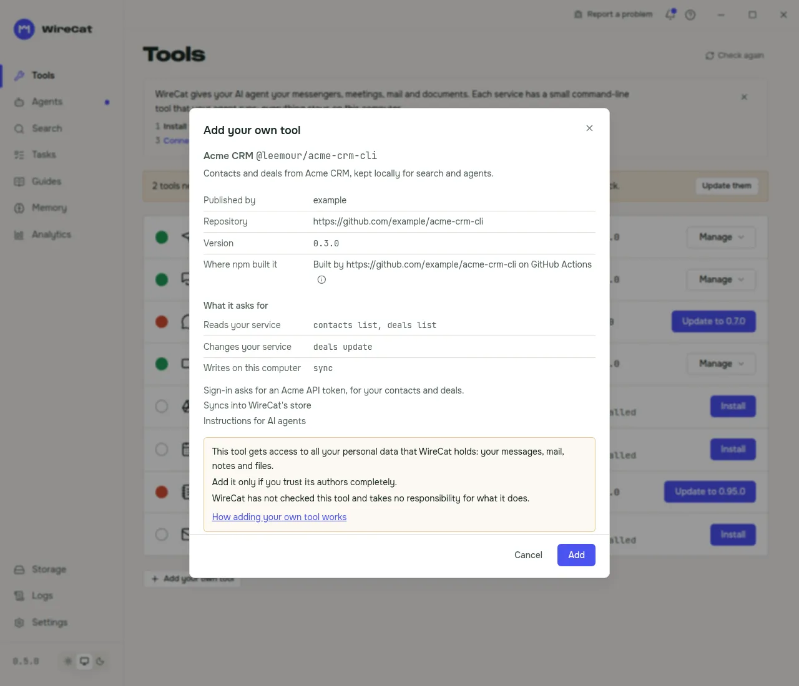</picture> |
| **The name.** WireCat reads npm only. | **The review.** Nothing is installed yet. |
| <picture><source media="(prefers-color-scheme: dark)" srcset="docs/images/own-review-risky-dark.webp">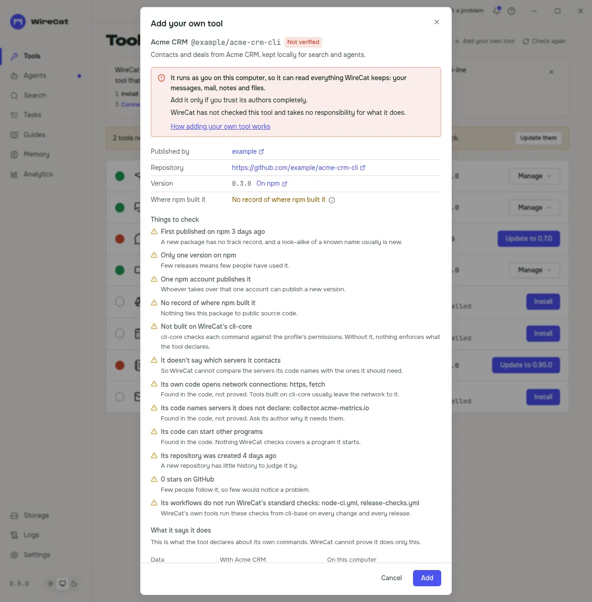</picture> | <picture><source media="(prefers-color-scheme: dark)" srcset="docs/images/own-check-dark.webp">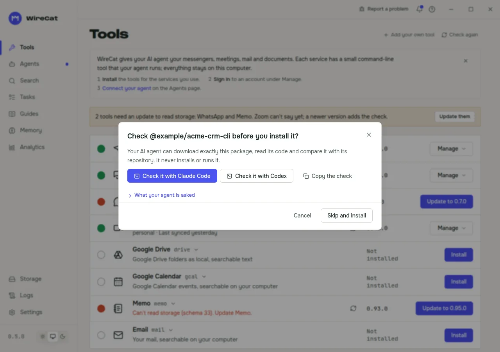</picture> |
| **Things to check**, each with a reason. | **The AI check**, offered before the install. |

#### The review screen

- **Not verified**, beside the name, and a red warning that holds for every tool: it runs as you, so it can read
  everything WireCat keeps. A tool built on cli-core, WireCat's own library, opens that data directly.
- **Published by**, **Repository**, **Version** and **Where npm built it**, each a link: the publisher's npm profile,
  the repository, the version's npm page, and, when npm recorded where it built the package, the release commit, the
  release workflow run and the entry in the public transparency log.
- **Things to check**, each with one sentence why. None of them blocks the tool:
  - from npm: first published less than 30 days ago, fewer than 3 versions, one publisher, no record of where npm
    built it;
  - its WireCat libraries: not built on cli-base 0.81.0 or later and cli-core 0.603.0 or later (before 1.0);
  - its code: network modules, `fetch` or `WebSocket` in its own code, servers its code names but does not declare,
    programs it can start, calls written so a reader does not see them, and native `.node` or `.wasm` files it cannot
    read. Every file of the package is read for code, not only `.js` files, and a file loaded as code that is not JavaScript by its name is flagged. These are "found in the code", not
    proved: the libraries the package bundles are skipped. Only the repository's address counts as the tool's own page;
    a homepage named in its code is a server like any other;
  - its manifest does not say which servers it contacts;
  - from GitHub: a repository created less than 30 days ago, no change for more than 180 days, archived, fewer than 10
    stars, or workflows at the release commit that do not run cli-base's standard checks (`node-ci.yml`,
    `release-checks.yml`). When GitHub cannot be reached it says "Couldn't check".
- **Servers it contacts**: the hosts the manifest declares, "contacts no servers", or "does not say", and a server you
  choose, such as your mail server.
- **What it says it does**: the data it touches (contacts, deals…) with its fields, and whether it reads or changes
  it with its service and on this computer. Then what its sync copies into WireCat's store, its standard commands
  (sign-in, check, agent instructions, MCP server…) in plain words, and the exact commands under **Commands**.

What the warning means:

- **"Where npm built it" is not a safety check.** It shows which repository npm built the package from. It does not
  show that the code is safe. "No record" means you cannot tell where the code came from.
- **"What it says it does" is what the tool says about itself.** WireCat cannot prove that a tool does only that.
- **Installing runs its code.** npm runs the package's install scripts with your permissions. That is why there are
  two confirmations, and the AI check before them.

#### Use it with your AI agent

An added tool works like any other. Open **Manage** on its row to sign in, sync and run its health check. If it has
instructions for AI agents or an MCP server, the **Agents** tab of **Tools** gives them to your agents.

#### Update it

The tool's **Update to** button opens the review again for the new version. It also lists what changed since the
version you confirmed: the repository, where npm built it, the publishers, new commands, new write access, and new or
changed parts. When anything changed, or the tool does not describe what it asks for, tick **I accept these
changes** before you can go on. The second question follows, as for a new tool.

#### Remove it

- **Remove from WireCat**, in the tool's details (click its name), deletes the tool's entry, and the tool leaves the
  list at once. When it is installed, the question offers **Uninstall it first**: the program stays installed
  otherwise. The Tools page then says it was removed and what stays on the computer.
- **Uninstall** removes the program. It can also delete the tool's own data folders: only the folders named after
  its package (`@scope/name` → `scope-name`). It never deletes the store your other tools share. A folder with that
  name that already existed before you added the tool is listed as kept and never deleted.

#### When WireCat refuses a tool

The dialog names the problem in a headline, such as **Tool not found**, then says what went wrong and what to do.
**Try again** goes back to the name, kept and selected, so you can fix it; when npm could not be reached, it reads
the same name again.

| The dialog says | What to do |
| --- | --- |
| Tool not found: npm has no package named … | Check the spelling, including the scope: `@scope/name`. |
| Only scoped package names work here | Ask the tool's author for its full npm name. |
| This name belongs to WireCat's own tools | Install it from the Tools page as a WireCat tool. |
| This tool does not describe itself to WireCat | Paste its `desktop` object from the tool's documentation into the dialog, or ask the author to publish a version with a manifest. |
| What the tool tells WireCat has a problem in … | Ask the author to fix it and publish a new version. |
| … already uses this tool's name, program or data folder | Two tools cannot share them. Ask the author to rename the tool. |
| … on WireCat's community list, already uses this tool's name | The tool is now listed. Remove your own entry and use the listed one. |
| npm says it was built by …, but the package names … | Do not add it. Tell the tool's author. |
| WireCat could not reach npm | Check your internet connection or proxy, then try again. |
| … is larger than WireCat reads | Ask the author to make the package smaller. |
| WireCat could not show this tool: … | Ask the author to fix it and publish a new version. |
| The package is installed, but WireCat did not add it | The program does not match the review. Click **Uninstall it**. |

| | |
| --- | --- |
| <picture><source media="(prefers-color-scheme: dark)" srcset="docs/images/own-refused-dark.webp">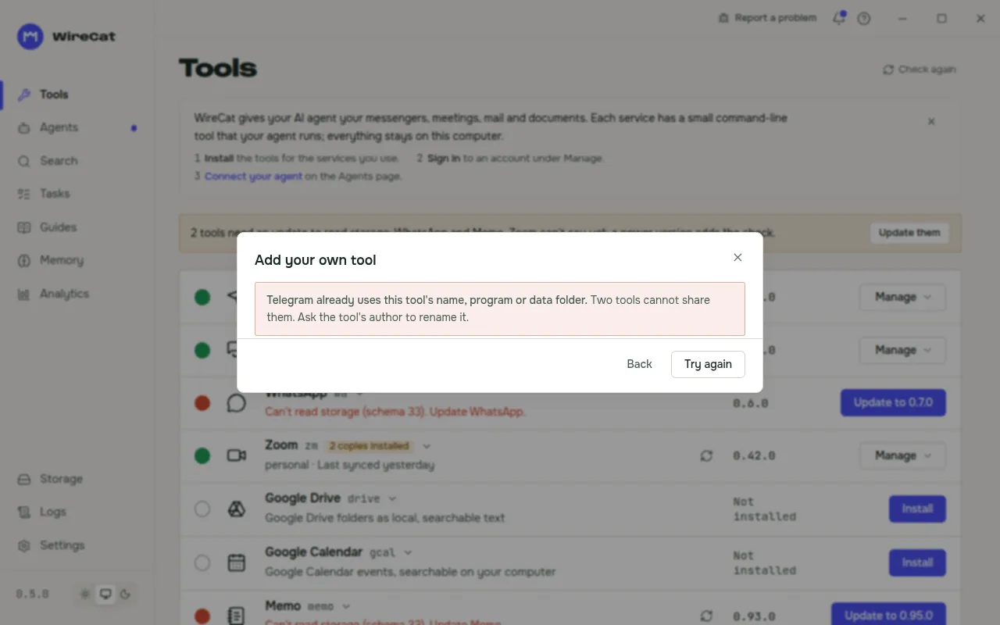</picture> | <picture><source media="(prefers-color-scheme: dark)" srcset="docs/images/own-tools-list-dark.webp">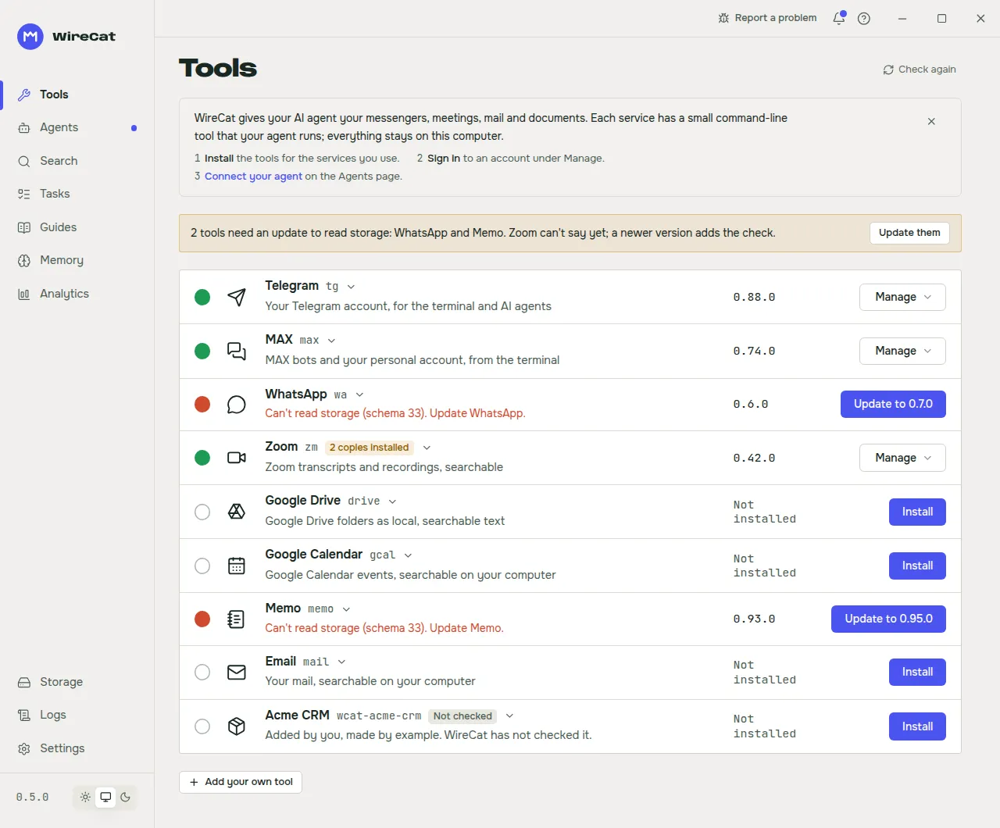</picture> |
| **A refusal** names the reason and what to do. | **An added tool** on the Tools page, marked **Not verified**. |

The full guide is on [wirecat.dev](https://wirecat.dev/en/docs/desktop#add-your-own-tool).

## For AI agents

The agent runs the tools. The app only prepares them.

- It finds Claude Code, Codex, Cursor, Gemini CLI, OpenCode, Hermes Agent and OpenClaw on your computer.
- For each agent it installs a tool's skill and registers its MCP server, using the tool's own commands.
- For ChatGPT and Claude in the browser, it starts the tool's HTTP MCP server and shows the address, a login code and
  the steps to click in that app.
- It looks for tools the way a terminal does, also when started from a launcher that has a short PATH (nvm, pnpm,
  Volta, Homebrew).

## Why WireCat Desktop

- **It is optional.** `npm install -g @wirecat/tg-cli` works exactly as before. Nobody needs the app.
- **The tools do the work.** The app runs each tool's own sign-in, sync and health check. It never reimplements them.
  A missing feature is added to the tool, not to the app.
- **It shows the real state.** Versions come from running the program, not from a package list. When something cannot
  be checked, the app says so.
- **It never picks an account for you.** Every command that needs an account profile uses the one you chose.
- **It asks for operations, not command lines.** The interface sends a tool id and checked arguments. The native part
  maps them to fixed programs. There is no shell plugin and no free command box.

## Security

- **Everything stays on your computer.** The app has no account and no server of its own for your data.
- **No administrator rights.** The app never calls `sudo` and never installs into a system folder. When a step needs
  more rights, it explains the fix.
- **Tool output is masked** (tokens, phone numbers, addresses and names) before it reaches the interface, the
  clipboard or a log. The run log is the one exception: you read it as the tool wrote it, and the tool has already
  hidden secrets and phone numbers.
- **Deleting data is narrow.** The app removes only each tool's own folders, only when no installed tool uses them,
  and only after you confirm in a dialog that lists every path. Emptying the shared archive uses the tool's own
  `store reset` behind a dialog that lists what it deletes. For a tool you added yourself, a folder that existed before you
  added it is never deleted.
- **Updates are checked.** An update is checked against a signature before it installs.
- **The app connects to** the npm registry (versions and installs), nodejs.org (only if you ask for its own Node.js),
  GitHub (updates and the cloudflared download) and `api.wirecat.dev` (only when you send a bug report).
- **A bug report is yours to send.** It becomes a public issue on GitHub. Email addresses, phone numbers and tokens are
  masked before it leaves your computer. Logs go to private storage and are never in the public issue. For a security
  problem, use the repository's [WireCat security policy](https://github.com/WireCatLabs/.github/blob/main/SECURITY.md) instead.

## When it does not work

- **"Node.js is needed"** or **"too old"**: use the app's offer to set up Node.js, or install Node.js 22.16 or newer
  yourself, then check again.
- **A tool is installed but the app does not find it:** the app lists every copy in PATH order. The first copy is the
  one a terminal runs. If an older copy comes first, remove it or put the newer one first.
- **An install stops:** the install panel names the reason and keeps the raw log one click away. Open **Report a
  problem** in the app to send it.
- **WireCat refuses a tool you add:** see [When WireCat refuses a tool](#when-wirecat-refuses-a-tool).
- **Hermes or OpenClaw cannot run a tool:** they start commands from their own PATH. The Agents tab of Tools shows the exact
  folders to add.

## Documentation

- [WireCat documentation](https://wirecat.dev)
- [Releases](https://github.com/WireCatLabs/wirecat-desktop/releases)
- [Architecture](docs/dev/ARCHITECTURE.md): the layers and how a request travels from a button to a process
- [Product](PRODUCT.md) and [design](DESIGN.md)
- [Bug report API](docs/dev/report-api.md)

## Development

```sh
pnpm install
pnpm dev        # the interface in a browser, with Rust mocked: http://localhost:1420
pnpm app        # the real desktop app
pnpm check      # types, lint, tests, rustfmt, clippy, Rust tests
```

To build from source you need Node.js, pnpm and a Rust toolchain. On Debian or Ubuntu, run `bin/install-linux-deps`
once for the Tauri build libraries; other systems are in
[Tauri's prerequisites](https://v2.tauri.app/start/prerequisites/). `pnpm build` builds the interface, and
`pnpm tauri build` makes the installers.

To try the real app without touching your own tools, settings and sign-ins, build it with
`pnpm tauri build --debug --no-bundle` and start it in a sandbox: `bin/sandbox demo --seed demo` (Linux). The presets
and what stays separate are in [the sandbox guide](docs/dev/guides/sandbox.md).

`pnpm dev` takes scenarios in the address, such as `?state=fresh` for a machine with nothing installed; the list is in
[CLAUDE.md](CLAUDE.md). Working rules for people and agents are in [CLAUDE.md](CLAUDE.md) and [AGENTS.md](AGENTS.md).

## Contributing

Bug reports and pull requests are welcome. Read the
[contributing guide](https://github.com/WireCatLabs/.github/blob/main/CONTRIBUTING.md) first. Where to ask
questions is in the [support page](https://github.com/WireCatLabs/.github/blob/main/SUPPORT.md).

## Part of WireCat

WireCat Desktop is one part of [WireCat](https://wirecat.dev), with the command-line tools it installs.

## Licence

Apache 2.0. See [LICENSE](LICENSE).
