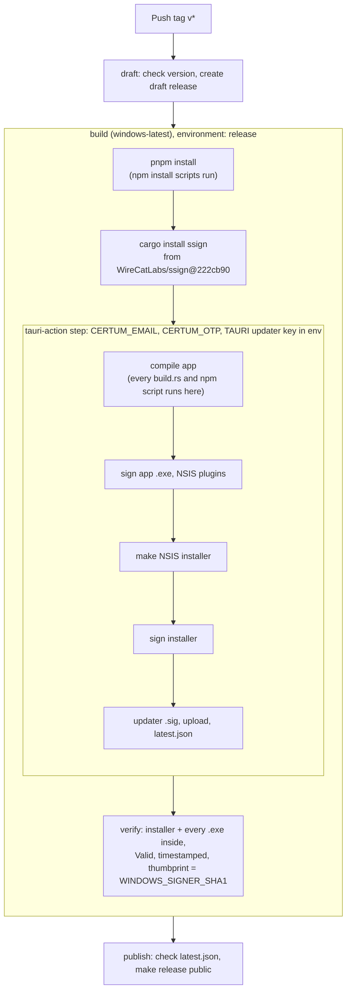
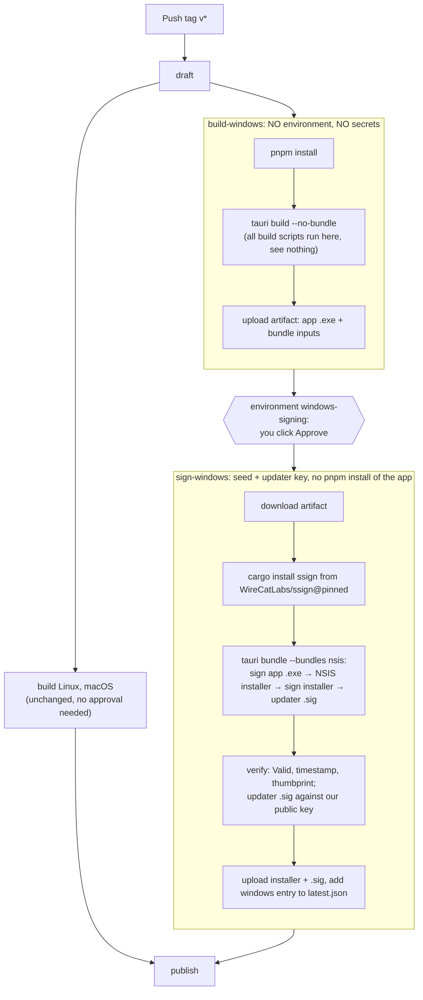
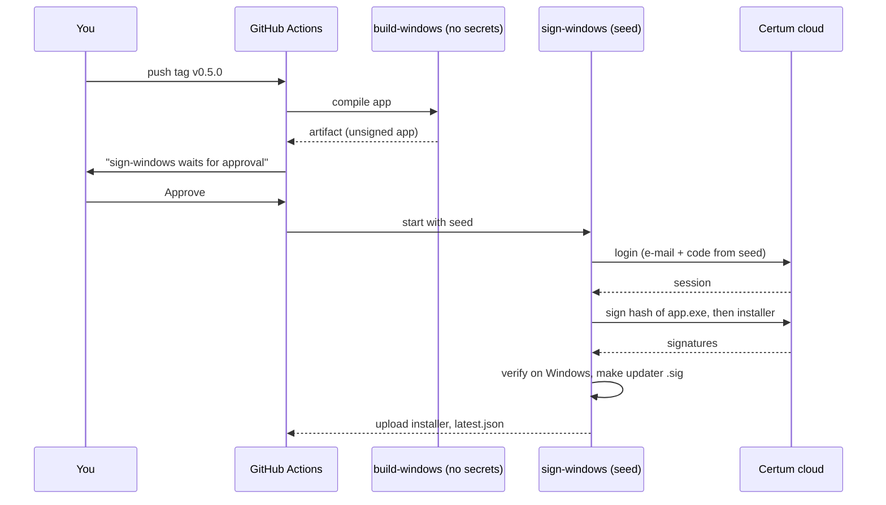

# Windows signing: the flow and the decisions

For the owner to review and decide. It compares the flow we have, the flow an outside review proposed, and the
flow I recommend, then lists each decision with options. Mark your answer under each decision (`Answer:`).

Related: [setup guide](2026-11-05-windows-signing-setup.md) · [ssign review](../research/2026-11-05-ssign-review.md) ·
[first-release plan](2026-10-29-first-release.md#windows-certum) · [`release.yml`](../../../.github/workflows/release.yml)

## 1. What we protect, and from whom

The SimplySign **seed** (the secret behind the 6-digit codes) plus the login e-mail is the whole credential. There
is no PIN. Whoever holds it can sign any program as WireCat, from anywhere, until Certum resets it by phone.

| Threat | What it gets | Which defence actually stops it |
| --- | --- | --- |
| **T1** A compromised npm or cargo dependency runs code during our build | Today: the seed, so it can sign anything, forever. Always: it can put malware into **this** release, which we then sign. | Seed isolation stops seed theft. Nothing in the signing flow stops the tainted release: only dependency review, lockfiles and audits do. |
| **T2** Someone with push rights pushes a `v*` tag from a bad commit | One signed release of that commit | Approval before signing (only you can push today, so this is about a stolen GitHub login) |
| **T3** Someone controls answers from Certum's servers, or the network path | ssign sends the session token or the login code to them | Patches P1, P2 in our ssign fork |
| **T4** ssign or Certum produces a wrong signature or a bad timestamp | A release Windows rejects, now or after the certificate expires | Independent verification on Windows (done in #131) |
| **T5** Upstream ssign changes | Anything | Our fork, pinned by full commit (done) |

The important line is T1. Moving the seed out of the build stops a stolen seed (the lasting harm), but a poisoned
dependency still gets its code into the app, and we sign it. The approval click does not catch that either: you
approve a tag, not the bytes. So isolation is worth doing for the seed, not because it makes the release itself
trusted.

## 2. The flow today (after #131)

One job per system. On Windows, one step builds, packages, signs and uploads, and holds the seed the whole time.

- Seed exposure: every build script in the compile, and anything the earlier steps planted on the runner.
- No approval: any `v*` tag signs. Missing secrets: Windows ships **unsigned** with a notice.

## 3. What the outside review says, and where I land

The outside review read the older commit (f7ba7b2) and the workflow before #131, so some of it is already done.

| # | Their item | Status | My view |
| --- | --- | --- | --- |
| 1 | Fork, start at v0.1.9, pin full SHA, `--locked` | **Done** (fork, #131) | Agree. Their "apply fixes first" is D1. |
| 2 | Allow-list Certum URLs before sending the token | Open (our P1) | Agree, and **before** the seed goes in: small, surgical, it is the token-leak path. |
| 3 | Restrict login redirects | Open (our P2) | Agree, same reason, same PR as 2. |
| 4 | Keep the seed out of compilation (they say High) | Open (NEED-2222) | Agree it is the biggest real exposure. I earlier said "after the first release"; I now say **before** the seed goes in, see D3. |
| 5 | Owner approval for every signing | Open (NEED-2221) | Agree. Conflicts with "fully automated" (NEED-134), so D2. |
| 6 | Fail closed: no unsigned Windows release | Open | Agree once the seed is set. D4. |
| 7 | Validate the RFC 3161 timestamp inside ssign | Open (our P4 is lighter) | Partly. Full validation is custom crypto in ssign; Windows already validates the timestamp when it checks the file. Add the nonce check (P4), skip the rest. D5. |
| 8 | Select the certificate by fingerprint | **Covered** by the thumbprint check in #131 | Selecting inside ssign adds little: the account has one certificate, and a wrong one fails the check. |
| 9 | Verify every artifact independently | **Mostly done** (#131); updater `.sig` not verified | Add the updater signature check. D6. |
| 10 | Updater signature after Authenticode | **Already true** inside `tauri build` | Only matters if we split; the split design below keeps the order. |
| 11 | Session cache on the runner | Open, low | The runner is thrown away after the job. Skip, or delete the cache file in the last step. |
| 12 | `cargo audit`, `cargo deny`, provenance | **Done** in the review (163 crates, v0.1.9 clean) | Repeat on each fork update. |
| 13 | Fuzz the Authenticode and ASN.1 code | Open | Skip. Windows verifies every file we ship; fuzzing defends against inputs we never feed it. |

Where I disagree with them: items 7 (in part), 8, 11 and 13. They add work and code in a fork we want to keep close to
upstream, and the Windows check at the end already catches what they would catch.

## 4. The flow I recommend

Windows is split into two jobs. The build job has no secrets. The signing job gets the seed and the updater key, runs
only after your approval, and never runs our dependencies' build scripts.

What it changes, and what it costs:

- **Seed exposure** drops from "every build script" to: the Tauri CLI, the NSIS tools it downloads, and ssign. Those
  are three pieces of code we can name.
- **The updater key** moves out of the Windows build job too (it is signed in the bundle step).
- **Order** is kept: the app `.exe` is signed before NSIS packs it, the installer before the updater `.sig` is made.
- **Cost:** tauri-action does the upload and `latest.json` for Windows today. In the split we do those two ourselves
  for Windows (`gh release upload`, a `jq` merge into `latest.json`). About a day of work plus one test tag.
- **Unverified:** that `tauri bundle` accepts a build made in another job (the [Tauri CLI docs](https://v2.tauri.app/reference/cli/)
  describe `bundle` as working on an already built app), and which files beyond the `.exe` it needs from `target/`.
  The first step of the work is a dry run on a test tag with no seed: the bundle job then makes an unsigned installer.
- **Approval** sits only on the signing job, so Linux and macOS never wait.

## 5. Decisions

### D1 · Patch the ssign fork before the seed goes into GitHub? (NEED-2224)

- **A** P1 + P2 (URL allow-list, redirect restriction) before the seed; P3 to P6 later
- **B** all six patches before the seed
- **C** none before; ship plain v0.1.9
- I'd pick **A**. P1 and P2 close the two paths where the token or the login code could leave Certum; each is a few
  lines with tests. The others protect less and can follow. (I said C earlier; the cost is small enough to do it now.)
- If you don't answer: A.

Answer: **B**, all six patches before the seed. They land in WireCatLabs/ssign first; then the `--rev` in
`release.yml` moves to the patched commit.

### D2 · Approve each signing by hand? (NEED-2221, against NEED-134)

- **A** a new environment `windows-signing` with you as required reviewer, on the signing job only
- **B** no approval, fully automated
- I'd pick **A**: one click per release, and it is the only thing between a stolen GitHub login and a signed release.
- If you don't answer: B, as NEED-134 says.

Answer: **B**, no approval for now; revisit later. The `release` environment stays as it is: only `v*` tags, no
reviewers.

### D3 · Split build and signing before the seed goes in? (NEED-2222)

- **A** yes, do the split (section 4) first, then store the seed
- **B** store the seed now with today's flow, split after the first signed release
- I'd pick **A**. The first signed release is the first time the seed is exposed; after that the exposure has
  already happened. A dry run without the seed tests most of it.
- If you don't answer: A, and the setup guide says to wait.

Answer: **A**, split first, then store the seed.

### D4 · Fail the release when Windows is not signed?

- **A** yes: on a `v*` tag, missing secrets or any signing or check failure stops the release
- **B** keep the fallback: Windows ships unsigned with a notice
- I'd pick **A**, switched on in the same PR that stores the seed. Until then every release would fail, so not earlier.
- If you don't answer: A, after setup.

Answer: **A**, fail closed. It switches on by itself: once any of `CERTUM_EMAIL`, `CERTUM_OTP` or
`WINDOWS_SIGNER_SHA1` exists, a missing one or any failure stops the release. Before the setup, none exists and
Windows ships unsigned with a notice.

### D5 · Timestamp: how much checking?

- **A** nonce check in ssign (P4) plus the Windows check we have
- **B** full RFC 3161 validation inside ssign
- I'd pick **A**: Windows already validates the timestamp's signature when it checks the file; B is custom crypto in
  a fork we want to keep small.
- If you don't answer: A.

Answer: **A**.

### D6 · Verify the updater signature in CI before publishing?

- **A** yes: check the Windows installer's `.sig` against the public key in `tauri.conf.json`
- **B** no, trust tauri's own step
- I'd pick **A**: a wrong `.sig` means no installed copy can update, and nobody notices until the next release. Tool
  to use (minisign-compatible check) to be confirmed in the work.
- If you don't answer: A.

Answer: **A**, for every platform's updater file, since one check in one job covers them all.

### D7 · Skip the outside review's items 8, 11, 13?

- **A** skip (certificate selection inside ssign, session cache work, fuzzing)
- **B** do them
- I'd pick **A**, reasons in section 3.
- If you don't answer: A.

Answer: **A**, skip them.

### Apple: does macOS need the same change?

Answer: yes. The five `APPLE_*` secrets and the updater key are repository secrets, which any branch can read, and the
macOS build had them in the same step as every build script. macOS gets the same split as Windows: compile with no
secret, then bundle, sign and notarize in a job in the `release` environment, and the owner moves the secrets there
with `bin/move-signing-secrets`.

## 6. Order of work if you take my picks

1. ssign fork: P1 + P2 with tests (PR in WireCatLabs/ssign), move the pin.
2. Desktop: split Windows into build and sign jobs, `windows-signing` environment, updater `.sig` check. Dry run on a
   test tag without the seed.
3. You: the [setup guide](2026-11-05-windows-signing-setup.md), storing the seed into `windows-signing` instead of
   `release`, and adding yourself as reviewer.
4. Desktop: fail closed (D4). First signed release.
5. ssign fork: P3 to P6 as they come.
